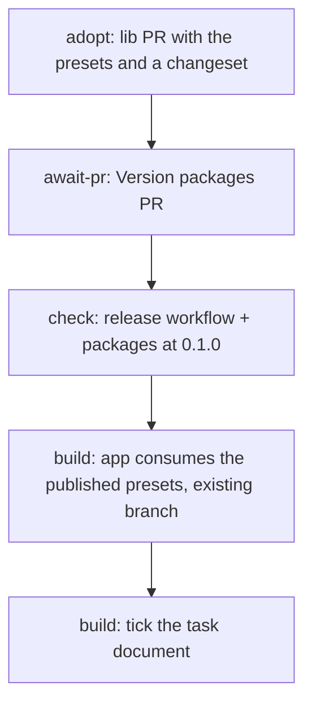

# esp-orchestrate Design

## Overview

`esp-orchestrate` takes one request that spans several pull requests, possibly across several repositories, all the way to merged code. It builds a graph of units, runs each pull request unit through `esp-ship`, waits on the things in between that are not pull requests (a release workflow, a published package), keeps the local checkouts tidy, and reports exactly what landed.

It stays thin: `esp-ship` keeps owning one task, one branch, one pull request. `esp-orchestrate` owns the graph, the order, the waits, the git housekeeping and the combined report.

`preflight -> intake -> graph + master plan -> [approve] -> schedule units -> (esp-ship unit | adopt PR | await bot PR | check) per unit -> housekeeping -> write-back -> summary`

## Goals

- One command for a multi-PR, multi-repo task: implement, open the pull requests, resolve every review comment, merge, clean up the local branches
- Adapt to the size of the work: a small cross-repo task gets one master plan and no per-unit planning, a large one lets each unit plan itself
- Fully unattended by default, stopping only on a critical finding; `--interactive` keeps the developer in the loop
- Always write the task graph to the run directory
- Resumable from files after an interruption or a context compaction

## Non-Goals

- Process-level orchestration (`claude -p` per unit, YAML workflows, runtimes): that is the job of agentic-forge
- Rollback of merged units: a partial run reports what landed, it never reverts on its own
- Changing the single-PR behavior of `esp-ship` beyond the additive flags listed in esp-ship Changes

## Inputs

The `[context]` can be any of:

- A prompt
- A task document (a file with numbered steps, `Depends on:` lines and progress checkboxes)
- A GitHub issue URL or `#<number>`, which may name work in several repositories
- A run directory from `esp-plan`

Intake turns the input into the master plan (`plan.md`) and the graph (`graph.json`). When the input is already a usable plan (a task document with clear steps), intake copies it as the master plan and only derives the graph.

## Units

A unit is one node of the graph. Each unit has an `id`, a `kind`, a `repo`, `depends_on`, and kind-specific fields.

| Kind       | What it does                                                                          | Runs through                         |
| ---------- | ------------------------------------------------------------------------------------- | ------------------------------------ |
| `build`    | Implements a change and ships it as a new pull request (or on an existing branch)     | `esp-ship`                           |
| `adopt`    | Takes over a pull request that is already open: wait, fix review, merge               | `esp-ship --pr <url>`                |
| `await-pr` | Waits for a pull request to appear (matched by head branch or author), then adopts it | `wait-for.mjs`, then `esp-ship --pr` |
| `check`    | Polls a command until it succeeds or times out (release run, registry version)        | `wait-for.mjs`                       |

The write-back of the source document is a `build` unit generated by intake (see Write-Back).

Per-unit settings: `merge` (`auto`, `human`, `none`; default `auto`), `review` (the `esp-ship --review` mode), `reviewers`, `max_rounds`, `draft`, `branch`, `checks` (`required` or `none-expected`), `timeout_minutes` (waits), and `plan` (`master` or `self`, see Sizing).

Merge policy prefers `auto`. A source document that says someone else merges a pull request does not switch the unit to `human` on its own: intake keeps `auto` and logs the decision. Only the request or the plan approval sets `human` or `none`.

### Example Graph

A library publishes shared presets, then an app switches to them:



## Sizing

Intake always writes the master plan: the graph plus a short brief per unit. Then it sizes each `build` unit:

- **Small** (inline-eligible by the `esp-ship` triage limits): the master plan holds the unit's full plan (or the source document's step, copied as-is). The unit runs `esp-ship --plan-mode skip` with that plan file
- **Large**: the master plan holds only the brief, and the unit's `esp-ship` run plans itself (`plan: self`)

Every sizing choice is a logged decision.

## Execution Model

### Options Considered

1. **Headless `claude -p` per unit**: rejected, duplicates agentic-forge and needs a permission story for unattended sessions
2. **Root session runs every unit's `esp-ship` loop inline**: no extra nesting, waits are free (background scripts wake the session), interactive checkpoints work. But the root context grows with every unit, and units never run in parallel
3. **One background subagent per unit, invoking `/esp-ship` through the Skill tool**: each unit gets a fresh context, units in different repositories run in parallel, and the root keeps only short replies

### Facts That Decide It

From the Claude Code documentation:

- A subagent can spawn subagents up to three layers below the main conversation by default (`CLAUDE_CODE_MAX_SUBAGENT_SPAWN_DEPTH`, `1` disables nesting)
- At most 20 subagents run at once in a session by default (`CLAUDE_CODE_MAX_CONCURRENT_SUBAGENTS`)
- Subagents can invoke skills through the Skill tool; a skill with `disable-model-invocation: true` cannot be invoked by the model (removed from `esp-ship`, see esp-ship Changes)
- Subagents cannot use `AskUserQuestion`; their permission prompts still surface in the main session
- When the main conversation compacts, subagent transcripts are unaffected

The depth of the agent tree under option 3:

- root (`esp-orchestrate`) -> unit subagent (`esp-ship`, depth 1) -> phase subagent, builder or verifier (depth 2) -> `esp-codex` relay (depth 3)
- `esp-review` already reviews in its own context when it is a subagent, so it adds no level

That fits the default limit, with no room left. Any skill that adds a level under a phase subagent breaks it.

### Decision

Option 3 by default, option 2 as the fallback, chosen per unit by `orchestrate.unit_mode` (`auto`, `subagent`, `inline`):

- **Subagent** (default): the root spawns a background `general-purpose` subagent per ready unit, which invokes `/esp-ship` with the unit's flags and `--run-dir <run>/units/<id>`, `--interactive off`
- **Inline**: the root invokes `/esp-ship` itself. `auto` picks it when `--interactive all` is given (checkpoints need `AskUserQuestion`), when the depth limit is below 3, or when only one unit is left and the root context is small

The root session also owns everything that is not a pull request: `check` and `await-pr` waits run as background scripts that wake the root on exit, so a wait costs no tokens and no subagent sleeps through it.

### Parallelism

- Ready units start at the same time up to `orchestrate.max_parallel` (default `2`)
- Units in the same repository never run at the same time: they share the checkout and the base branch
- While units run or waits are pending, the root ends its turn; the next notification (a unit reply or a wait exit) wakes it, and `orchestrate.mjs next` decides what runs next

## Run Directory

One parent run, with each unit's `esp-ship` run nested inside it:

```text
<runs.root>/<date>-<slug>/
  run.json              parent run (workflow: esp-orchestrate)
  orchestrate.json      orchestrator state, owned by orchestrate.mjs
  graph.json            the task graph (units, edges, status per unit)
  plan.md               master plan
  request.md            the original request
  decisions.jsonl       orchestrator decisions
  waits/<id>.json       wait clocks, so a resumed wait keeps its deadline
  units/<id>/           a full esp-ship run directory (ship.json, plan.md, decisions.jsonl, summary.md)
  summary.md            combined summary
```

`runs.mjs create --parent <dir>` records the link both ways. `esp-recap` lists the units under their parent and reads their decisions.

## State and Resume

`scripts/orchestrate.mjs` is the only writer of `orchestrate.json` and `graph.json`, like `ship.mjs` for `ship.json`. Commands: `init`, `intake --record`, `next`, `unit start|done|failed|blocked`, `wait start|record`, `housekeep`, `outcome`. `next` returns one action: `spawn-unit`, `run-unit-inline`, `start-wait`, `housekeep`, `checkpoint`, `idle` (end the turn and wait for a notification), `finish`.

Files are the truth. `/esp-orchestrate --resume --run-dir <dir>` rebuilds everything from disk:

- A unit marked running whose subagent is gone resumes with `esp-ship --resume --run-dir <run>/units/<id>`
- A wait marked started restarts with its state file, keeping its deadline

## Critical Stops

Unattended, the orchestrator decides, logs and continues, except on:

- A B-Decide item with no default policy
- A security or data-loss finding still open after the unit's fix rounds
- A destructive git operation: force-push outside a task branch, deleting a remote branch the run did not create, rewriting shared history
- An architecture change or large refactor that the plan does not contain

Merging a pull request that triggers a publish or a release is not a stop: the plan already contains it.

A critical stop ends the unit as `awaiting-human`. Its dependents are blocked; independent units still finish.

## Interactive Mode

`-i|--interactive <mode>`:

- `off` (default): fully unattended
- `plan`: approve the graph and the master plan, then run unattended
- `all`: also before each unit starts and before each merge; units run inline so `esp-ship` can ask its own checkpoints

A unit subagent that returns `needs-decision` is asked in the root (in `plan` or `all` mode) and resumed with the answer recorded as an operator note; in `off` mode it is a critical stop.

## Git Housekeeping

After a unit merges, in that unit's repository checkout, only when the checkout is clean:

1. Check out the base branch and fast-forward it to `origin/<base>`
2. Delete the local task branch once `gh pr view` reports it merged (squash-safe, never `git branch --merged`)
3. Remove the worktrees the run created
4. For each later unit in the same repository with an existing branch: rebase it onto the new base, and rerun its gates before its pull request opens or updates

A dirty checkout is left alone and named in the summary.

## Repositories

Each unit names a repository as `owner/name`. The checkout is resolved in order:

1. `orchestrate.repos` (`owner/name` -> path)
2. A sibling directory of the current repository whose `origin` matches
3. Ask (interactive), or clone under `worktrees.root` (unattended)

Preflight checks, for every repository: a git checkout, `gh` access, the path is inside the session's allowed directories (otherwise every edit prompts: add it with `/add-dir` or `additionalDirectories`), and the tokens the plan names (registry tokens for a `check` against a private registry).

## Write-Back

When the input is a task document, intake adds a final `build` unit in the document's repository: tick the checkboxes, set each step's status, add the pull request links, within the repository's own rules on where local IDs may appear. When the last code unit in that repository has not merged yet, the edit goes into that unit's pull request instead.

## Outcome

Statuses: `merged` (every unit landed), `partial` (some units landed, others stopped or blocked), `awaiting-human`, `halted`, `failed`. The report lists each unit with its kind, repository, pull request, merge commit or stop reason, and the next command (`/esp-orchestrate --resume --run-dir <dir>`).

## esp-ship Changes

Each is useful on its own:

1. Remove `disable-model-invocation` and rewrite the description for model invocation
2. `--pr <url>`: adopt an open pull request; the run starts at the review wait, with no plan, build or new pull request
3. `--merge-policy <auto|human|none>`: `human` waits in the background until someone else merges, then finishes as `merged`
4. `--checks none-expected`: a pull request that runs no checks (one opened with `GITHUB_TOKEN`) merges without the grace-period wait, logged as a decision
5. `--parent-run <dir>`: record the parent in `run.json`, read the parent's frozen config
6. Rebase onto `origin/<base>` before opening the pull request when the base moved since the branch was created, then rerun the gates
7. Per-repository config: the run freezes the config of the unit's repository, not of the session's working directory

## Known Risks

- ⚠️ **Required checks on bot pull requests**: when the base branch requires checks, a pull request opened with `GITHUB_TOKEN` never starts them and cannot merge. Not handled for now: a unit whose pull request cannot merge is a critical stop (`awaiting-human`), with the blocking condition from `esp-merge` in the report. Known fixes, for a later version: a GitHub App token or PAT in the release workflow, or an empty commit pushed with the user's credentials to start the checks
- ⚠️ **Depth limit**: the subagent mode uses all three default levels. A lower `CLAUDE_CODE_MAX_SUBAGENT_SPAWN_DEPTH` must switch to inline mode, never fail mid-run
- **Waits inside a unit subagent**: `esp-ship` in a subagent waits for reviews in the foreground, in 10-minute commands. It costs no tokens, but whether a background subagent can instead end its turn and be woken by a background script is undocumented: the first milestone tests it. Either way, subagent stays the default unit mode: a foreground wait only keeps the subagent alive longer
- **Working directory**: a subagent starts in the root's directory. Every unit prompt and every script call names the unit's repository explicitly (`--project-dir`, `git -C`)
- **Root context**: the root keeps only unit replies and wait results; a compaction loses nothing because `orchestrate.mjs next` rebuilds the state
- **Concurrent subagents**: two parallel units, each with a builder and a verifier, stay far below the 20-subagent limit, but `max_parallel` should not go above 4

## Configuration

New `orchestrate` section:

- `repos` (`{}`): `owner/name` -> local path
- `unit_mode` (`auto`): `auto`, `subagent`, `inline`
- `max_parallel` (`2`)
- `wait.timeout_minutes` (`60`), `wait.interval_seconds` (`30`)
- `housekeeping` (`true`): the steps of Git Housekeeping
- `write_back` (`true`)

No run-level budget (wall-clock or tokens): the existing limits bound a run, the wait timeouts and the fix rounds per unit (`--max-rounds`, passed through per unit).

## Implementation Milestones

Two pull requests, with a single version bump in the second one.

### Pull Request 1: esp-ship Changes

1. Spike: a background subagent invokes `/esp-ship` on a throwaway repository, through the pull request wait, at depth 3; record what works
2. `runs.mjs` parent and child runs (`--parent`), needed by `--parent-run`
3. `esp-ship` changes 1 to 5, with tests
4. `esp-ship` changes 6 and 7, with tests, and the `esp-ship` README section

No version change and no CHANGELOG entry: they ship with pull request 2.

### Pull Request 2: esp-orchestrate

1. `orchestrate.mjs`: graph schema, state, `next`, and their tests in the style of the `ship.mjs` tests
2. `wait-for.mjs`: generic command and pull-request-appears waits with a persisted clock
3. Git housekeeping script and its tests
4. `esp-orchestrate` SKILL.md and references (intake, sizing, units, housekeeping), plugin manifest, config schema and defaults
5. `esp-recap` support for parent and child runs
6. README, CHANGELOG and the version bump, covering both pull requests
